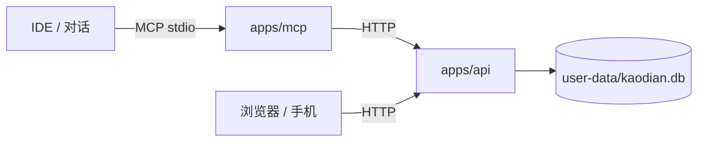

# 考点 · Kaodian

> **Agent 的作答终端。** 你在对话里让 Agent 出题、给提示，在网页上作答；计时和结果自动回传，Agent 接着安排下一组或讲解。
> 本地优先、无账号、数据在你自己机器上。



AI **不在网页里跑**：它是 IDE 里的 MCP 客户端，通过 stdio 启动 `apps/mcp/server.py`，再由这个桥调本地 API。网页只是它让你作答的终端。

## 能做什么

| 模块 | 能力 |
|---|---|
| 学习路径 | 节点式课程、连续天数、每日目标、XP，按科目分路径 |
| 讲义 | Agent 写入 Markdown：KaTeX 公式、Mermaid、SVG 动图、`math-graph` 可拖交互图 |
| 组卷 / 作答 | 按考点、题型、题量组卷；单题一屏、计时、标记、主观题 |
| 判分 | 客观题即时判分；主观题进队列由 Agent 按 rubric 评分 |
| 复习 | 连对 3 次掌握度 +1，答错 −1；间隔 1/3/7/15/30 天 |
| 协作 | 提示条、卡住求助、交卷回传；MCP 暴露 19 个工具 |
| 代码练习 | 讲义左侧 gcc + bubblewrap 终端（默认关闭） |

## 快速开始

需要 Python 3.11+、Node 20.19+；代码练习另需 `gcc` 与 `bubblewrap`。

```bash
make check   # pytest + 前端 lint + 构建，提交前跑一遍
```

```bash
make setup          # 建 venv、装后端 + MCP 依赖、npm ci

# 终端 1：后端
make dev-api        # http://127.0.0.1:8000

# 终端 2：前端
make dev-web        # http://127.0.0.1:5173
```

单端口运行（FastAPI 托管前端构建产物）或 Docker：

```bash
make build && cd apps/api && ../../.venv/bin/uvicorn app.main:app --host 127.0.0.1 --port 8010
make docker                 # 非 root 容器，自动用当前 UID/GID，http://127.0.0.1:8010
```

## 接入 AI（MCP）

```bash
opencode mcp add kaodian --global \
  --env KAODIAN_API=http://127.0.0.1:8010 \
  --env KAODIAN_WEB=http://127.0.0.1:8010 \
  -- /path/to/kaodian/.venv/bin/python /path/to/kaodian/apps/mcp/server.py
```

Claude Desktop / Cursor / VS Code（Cline、Continue）等任何支持 MCP stdio 的客户端都可以接，配置见 [`docs/ai/integration.md`](docs/ai/integration.md)。

## 目录

```
apps/web/   前端（React + Vite + TS）      apps/api/   后端（FastAPI + SQLite）
apps/mcp/   AI 桥（stdio MCP → API）       config/    科目、考纲、种子题库
docs/       文档（产品 / 开发 / AI / 内容）  scripts/   大纲导入、冒烟
user-data/  用户数据（作答、进度、复习），不进 Git
```

| 位置 | 内容 | 进 Git |
|---|---|---|
| `apps/` `config/` `docs/` | 源码、配置、文档 | ✅ |
| `user-data/kaodian.db` | 作答、时长、复习、进度 | ❌ |
| 私有学习工作区 | 讲义源文件、计划、日志（不在本仓库） | ❌ |

## 文档

| 我想… | 读 |
|---|---|
| 了解定位与功能 | [`docs/product/overview.md`](docs/product/overview.md) |
| 看模块与数据流 | [`docs/dev/architecture.md`](docs/dev/architecture.md) |
| 本地开发 / 测试 | [`docs/dev/development.md`](docs/dev/development.md) |
| 调 API | [`docs/dev/api.md`](docs/dev/api.md) |
| 让 AI 接进来 | [`docs/ai/integration.md`](docs/ai/integration.md) |
| 出题 / 审题 / 评分 | [`docs/ai/pipelines.md`](docs/ai/pipelines.md) |
| 写讲义 / 加图 | [`docs/content/format.md`](docs/content/format.md) |

完整索引：[`docs/README.md`](docs/README.md)。

## 安全与版权

- 默认只绑 `127.0.0.1`，无账号体系，**不要暴露公网**；
- 代码沙箱默认关闭，`KAODIAN_ALLOW_CODE_RUN=1` 才启用，且断网、只读系统；
- AI 生成的题先入库 `pending`，主 Agent 审查后才可组卷；
- 素材只用可自由使用的来源并记录许可证，真题注明「改编自 X 年真题」。

## License

- 代码：MIT，见 [`LICENSE`](LICENSE)。
- 素材：`apps/web/public/素材库/` 按该目录的 [`LICENSE-素材.md`](apps/web/public/素材库/LICENSE-素材.md)，含 CC0 / CC BY / CC BY-SA，发布页面时保留署名。
- 种子题：`config/questions/` 为公开真题改编的教学示例，不是原卷；正式使用前请自行核对来源与版权。
