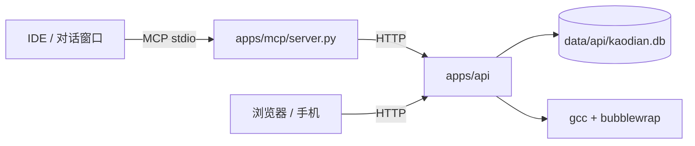

# AI 如何运行在这个项目里

## 一句话

**AI 不在网页里跑。** 它是 IDE / 终端里的 MCP 客户端，通过 stdio 启动 `apps/mcp/server.py`，再由这个桥去调本地 API。网页只是它让你作答的终端。



## 三种角色

| 角色 | 跑在哪 | 做什么 |
|---|---|---|
| 对话 Agent | IDE 插件 / 终端 / Claude Desktop | 决定学什么、出题、给提示、读结果、评分 |
| MCP 桥 | 本机 Python 进程（由 Agent 启动） | 把 API 包装成 27 个工具 |
| 学习终端 | 浏览器 | 显示讲义、答题、计时、把事件写回 API |

## 常见 IDE / 客户端

| 宿主 | 接入方式 |
|---|---|
| **OpenCode**（当前使用） | `opencode mcp add …` |
| Claude Desktop | `claude_desktop_config.json` 里配 `mcpServers` |
| Cursor | Settings → MCP → 添加 stdio server |
| VS Code（Cline / Continue） | 在扩展的 MCP 配置里加 stdio server |
| JetBrains AI Assistant | 支持 MCP 的版本里添加 stdio server |

> 不需要为本项目写 IDE 插件。任何支持 MCP stdio 的客户端都能接。

## HTTP 模式（脱离 IDE）

```bash
bin/kaodian mcp --transport http --port 8020
# 客户端连接 http://127.0.0.1:8020/mcp
```

无鉴权，只绑本机；远程访问必须加反向代理和 token。

## 接入命令（OpenCode）

```bash
opencode mcp add kaodian --global \
  --env KAODIAN_API=http://127.0.0.1:8010 \
  --env KAODIAN_WEB=http://127.0.0.1:8010 \
  -- /path/to/kaodian/.venv/bin/python /path/to/kaodian/apps/mcp/server.py
```

Claude Desktop 的等价配置：

```json
{
  "mcpServers": {
    "kaodian": {
      "command": "/path/to/kaodian/.venv/bin/python",
      "args": ["/path/to/kaodian/apps/mcp/server.py"],
      "env": {
        "KAODIAN_API": "http://127.0.0.1:8010",
        "KAODIAN_WEB": "http://127.0.0.1:8010"
      }
    }
  }
}
```

> 改完配置后 OpenCode 一般会自动重载；工具列表没更新就 `/reload` 或开新会话。

## 工具（27 个）

| 分类 | 工具 |
|---|---|
| 读 | `list_subjects` `list_outline` `list_pages` `list_quizzes` `get_attempt` `get_due_reviews` `get_stats_today` `get_progress` `get_profile` |
| 画像 | `update_profile` |
| 出题 | `create_questions` `list_pending_questions` `review_questions` |
| 组卷 | `create_agent_session` `build_quiz` |
| 协作 | `send_hint` `read_inbox` |
| 评分 | `get_grading_queue` `grade_answer` |
| 讲义 | `publish_page` `update_page` |
| 网页编辑 | `get_page_draft` `save_page_draft` `publish_page_draft` `validate_content` |

工具总数仍为 27；画像相关只扩展了 `update_profile` 的参数（v3 志愿表、分科目标、阶段计划）。

### 画像补全

`get_profile()` 返回
`{static, dynamic, completeness, missing, next_questions, phase}`：

- `completeness`：必填 8 项（`target_exam` `target_date` `target_score` `targets`
  `target_major` `daily_minutes` `subjects` `motivation`）完成比例；
- `missing`：按必填顺序列出未填字段；`targets` 为空但有 `target_school` 也算已填；
- `next_questions`：建议接下来问的中文问题（必填优先，最多 6 条）；
- `phase`：当前阶段 `{name, goal, start, end, daily_minutes, days_left, progress}`，
  没有阶段时为 `null`。

`update_profile(...)` 支持：

- 升学目标：`target_exam` `target_date` `target_score` `exam_total` `hard_lines`
  `targets` `target_school` `target_major` `target_region` `backup_school`
  `backup_major` `exam_type` `current_education` `graduation_year`；
- 分科目标：`subject_targets`（`{科目 id: 分数}`，键必须来自 `list_subjects`）；
- 学习条件：`daily_minutes` `subjects` `study_window` `constraints`；
- 阶段计划：`plan_phase`（P1/P2/P3）`phase_start` `phase_end`
  `phase_daily_minutes` `phase_goal` `total_hours`；
- 自我评估：`strengths` `weaknesses` `motivation`；
- AI 摘要：`ai_summary`（≤2000 字，和用户手写的 `notes` 分开，互不覆盖）；
- `source`：默认 `agent`，写入 `updated_by`。

`targets` 用 JSON 数组一次传，不拆成多个参数：

```json
[{"tier": "冲", "school": "示例大学 A", "major": "计算机科学与技术",
  "score": 424, "rank": 120, "location": "珠海（协同培养）", "note": ""}]
```

`tier` 只能是 `冲` / `稳` / `保` / `兜底`，最多 8 条；写入后
`target_school` / `backup_school` / `backup_major` 自动同步，显式传值优先。

推荐流程：

```
get_profile
→ 看 phase 与 missing / next_questions
→ 一次只问 2–3 个问题（先目标院校/专业/动机，再时间限制和薄弱点）
→ update_profile(..., source="agent", ai_summary="...")
→ 再 get_profile 确认完整度
```

不要一次问完所有问题；用户没回答的字段不要臆造。

## 一次典型循环

1. 你说「按 C-08 出 6 道」；
2. Agent 先 `get_profile` 看目标、完整度、缺失字段和薄弱考点，再用 `list_outline` 确认编号，`build_quiz` 组卷，把链接发你；
3. 你打开链接作答，卡住点「卡住了」；
4. Agent 用 `read_inbox` 读到求助，用 `send_hint` 推提示；
5. 交卷后 Agent 用 `read_inbox` / `get_attempt` 读结果；
6. 主观题进 `get_grading_queue`，Agent 用 `grade_answer` 写回分数。

## 为什么不让 AI 直接写数据库

- 网页和 AI 共用一套校验/判分/复习逻辑；
- AI 只传结构化参数，不碰 SQL；
- 出题先进 `pending`，审核后才上架；
- 代码执行走独立沙箱。

## 安全边界

- 默认只绑 `127.0.0.1`，没有账号体系，**不要暴露公网**
- `KAODIAN_ALLOW_CODE_RUN=1` 才启用代码沙箱；即使启用也是断网 + 只读系统
- MCP 的 `KAODIAN_API` 指向本地；不要让远程客户端直连
- AI 写的讲义/题目是**内容**，发布前由主 Agent 审查

协议细节（事件、字段、错误码）见 [`protocols/agent.md`](protocols/agent.md)。
