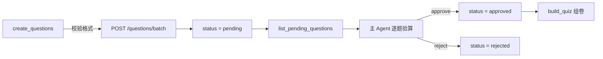

# AI 内容流水线

> 三条流水线：**出题 → 审查 → 上架**、**讲义草稿 → 验收 → 发布**、**交卷 → 评分队列 → 写回**。
> 所有写操作都走 API；AI 不直接改数据库，子 Agent 不发布、不审题、不 commit。

## 1. 出题：生成 → pending → 审查 → approved



- 入库只表示**格式合法**，不表示答案正确。
- 只有 `approved` 能被组卷；`rejected` 留在库里但永不抽中。
- 题干按归一化文本去重，重复提交是幂等的。

### 题目 JSON

```json
{
  "outline_code": "C-08",
  "type": "single",
  "stem": "执行 `int a=1; while(a<4) printf(\"%d\",a++);` 的输出是（ ）",
  "options": ["1", "12", "1234", "123"],
  "answer": ["D"],
  "explanation": "a 依次为 1、2、3 时打印，随后 a 变成 4，条件不成立退出。",
  "difficulty": 1,
  "score": 3,
  "source": { "kind": "ai", "model": "your-model", "date": "2026-11-01" },
  "tags": ["while", "后置自增"],
  "verified": false
}
```

主观题额外要求 `reference_answer` 与 `rubric`，且评分点分数之和等于 `score`：

```json
{
  "outline_code": "D-03",
  "type": "short",
  "stem": "简述顺序表与链表的优缺点。",
  "explanation": "按「顺序表—链表—对比」三段作答。",
  "reference_answer": "……",
  "rubric": [
    { "point": "顺序表支持随机访问 O(1)", "score": 3 },
    { "point": "链表已知位置插入删除 O(1)", "score": 3 },
    { "point": "顺序表插入删除需移动元素", "score": 2 },
    { "point": "链表不支持随机访问", "score": 2 }
  ],
  "score": 10,
  "difficulty": 2
}
```

### 题型

| type | 说明 | answer 形式 |
|---|---|---|
| `single` | 单选 | 1 个大写字母，如 `["D"]` |
| `multiple` | 多选 | ≥2 个字母，不能等于全部选项 |
| `judge` | 判断 | `["true"]` / `["false"]` |
| `fill` | 填空 | 非空字符串数组 |
| `short` / `calc` / `essay` | 主观题 | 用 rubric 评分，需 `reference_answer` |
| `code` | 代码题 | 主观评分或沙箱运行 |

### 校验规则（服务端强制）

- `outline_code` 必须存在，且与 `subject_id` 匹配——**不要自己编编号**；
- `explanation` 至少 10 字；
- `difficulty` 为 1–5 的整数；
- 选项 2–8 个、无重复、无空项；单选唯一答案，多选不能全选；
- 主观题必须有 `reference_answer`、`rubric`，且 `rubric` 总分 = `score`；
- 题干去重。

写题前先用 `list_outline` 确认编号；批量提交前可先 `POST /questions/validate` 只校验不入库。

## 2. 讲义：文件 → 校验 → 同步

持久内容在**内容仓库**，不在 API 里直接写：

```text
子 Agent 写 packs/<subject>/lessons/*.md
  → bin/kaodian content validate
  → bin/kaodian content sync
  → HTTP GET /api/pages 确认
```

- frontmatter 里 `status: draft|published|archived` 决定是否上线；
- `lesson_key` 决定路径顺序，与创建时间无关；
- `publish_page` 只用于运行时的临时页（`pack_id IS NULL`），不进入内容仓库；
- 题库同理：种子题写 `packs/<subject>/questions/*.json`，运行时 AI 生成的题走 `create_questions`（pending）。

主 Agent 验收：读正文、校对例题、跑 `content validate`，确认后提交内容仓库。

## 3. 主观题：交卷 → 评分队列 → 写回

```text
学生交卷
  → 客观题立即判分
  → 主观题 response 入库，score = NULL
  → attempt.grading_status = pending
Agent
  → get_grading_queue
  → grade_answer(attempt_id, question_id, score, feedback)
  → 写回 score/correct/feedback，重算本次总分
```

评分依据是 `rubric` + `reference_answer` + 学生原文，**不是学生自评**。自评只作参考。

## 4. 子 Agent 缓存协议

课程不等到学到才写，主 Agent 可以提前派发后几章：

| 角色 | 可以 | 不可以 |
|---|---|---|
| 子 Agent（教学） | 写 `.md`、调 `create_questions`、`publish_page(status=draft)` | 审题、组卷、发布、commit、改代码 |
| 子 Agent（开发） | 改代码、跑测试、跑构建 | 改讲义、动 `runtime/`、commit |
| 主 Agent | 验收、`review_questions`、`update_page(published)`、提交 | 把长日志整段带进主上下文 |

- 子 Agent 只回报：文件、行数、测试结果、不确定处。
- 缓存内容必须带 `lesson_key` 和 `outline_code`，否则路径排不上、题挂不住。
- 一次只推进 1–2 章，避免大量待审内容积压。

## 5. 常见错误

| 现象 | 原因 | 处理 |
|---|---|---|
| 组卷抽不到题 | 题还是 `pending` | 先 `review_questions` approve |
| 422 且带 errors | 批量里有一条不合格 | 整批回滚，逐条修 |
| 路径里没有新页 | `status=draft` 或 `lesson_key` 缺失 | 改 published / 补 key |
| 交卷后一直待评分 | 没有 Agent 拉队列 | `get_grading_queue` |
| 同一题反复出现 | 题干归一化后不同（空格/标点） | 统一题干写法 |

接口字段见 [`../dev/api.md`](../dev/api.md)，工具清单见 [`integration.md`](integration.md)。
