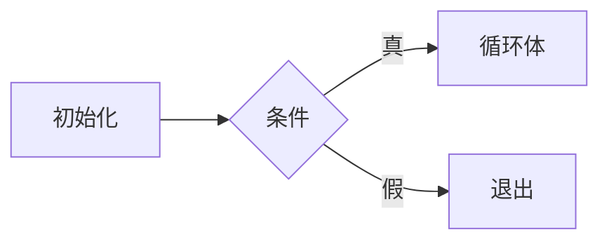

# 讲义格式规范

> 讲义只有一个来源格式：**Markdown**。网页只多认两种代码块（`mermaid`、`math-graph`），其余按 GFM + KaTeX 渲染。
> 不写内嵌 HTML、iframe、`<script>`、内联样式。

> 内容仓库：`~/code/kaodian-content`。正文里的 `/media/<pack>/...` 由框架的 `/media` 路由提供。

## 1. 一课一概念

- 一页只讲**一个**可独立出题、独立复习的最小概念；
- 目标 10–15 分钟，正文 **≤120 行**；
- 出现「定义 + 法则 + 应用 + 特例」就拆页，不要塞进同一页；
- 拆分页 `lesson_key` 用 `M02-1`、`M02-2`…，路径按 key 排序；
- 旧的大页拆完转 `draft` 并归档，不要和新页同时出现在路径里。

### 固定结构

```markdown
---
科目: 高数
章节: 02-1
主题: 导数定义与切线
难度: 入门
掌握度: 0
上次复习: —
下次复习: 2026-11-05
来源: 考纲 M-09 + 2003–2019 真题
---

# 导数 1/7 · 定义与切线

> 对应 **M-09** ｜ 约 12 分钟

## 一句话

## 这节在考试里怎么考

## 直觉 / 定义

## 举三反一

## 两个易错点

## 自测（3 题）

## 答案

## 一句话
```

- **举三反一**：3 个递进例子（具体 → 一般 → 反例/边界），每个都写完整过程；
- 考频只写 2–3 行，不放大表（大表在考纲里）；
- 每页至少 1 个图或表；自测 3 题、答案放文末。

## 2. 公式（KaTeX）

- 行内：`$f'(x_0)$`；块级：`$$ ... $$`；
- 支持 `\dfrac`、`\begin{cases}`、`\lim`、`\sqrt[3]{}` 等常用宏；
- 反斜杠在 JSON 里要写两次（`\\frac`），在 Markdown 文件里写一次。

**跨行 `$$` 必须合并成单行。** 渲染器遇到跨多行的 `$$...$$` 会吞掉紧随其后的 Markdown 图片：

```markdown
<!-- 错误：会把下一行图片吞进公式 -->
$$
f'(x)=\lim_{\Delta x\to0}\frac{\Delta y}{\Delta x}
$$


<!-- 正确 -->
$$f'(x)=\lim_{\Delta x\to0}\frac{\Delta y}{\Delta x}$$

```

## 3. 图片

```markdown

```

- 路径统一 `/media/<pack>/xxx.svg`，文件在内容仓库 `packs/<pack>/assets/`；
- 命名 `科目-主题-序号.svg`，如 `math-deriv-1.svg`；
- **alt 就是图注**，渲染时自动显示在图下方，必须写清「图几：说明」；
- 用 `` 引用 SVG 时是独立文档，**不能用 `:root` + `var(--x)`**：

```svg
<style>
  .bg { fill: #ffffff; }
  .ink { fill: #1b1b18; }
  @media (prefers-color-scheme: dark) {
    .bg { fill: #1a1d1a; }
    .ink { fill: #eae8e1; }
  }
</style>
```

- 必须显式写 `width` / `height` / `viewBox`，否则不同屏幕下缩放不一致；
- 不要加 `loading="lazy"`（首屏下方图片会不加载）；
- 会动的图用 SMIL（`<animate>` / `<animateMotion>`），不依赖 JS。

## 4. Mermaid

````markdown

````

- 用于流程、结构、时序，不用来画函数图象；
- 节点文字含空格/符号时加引号：`A["i <= 4 ?"]`；
- Mermaid 块内不要写 KaTeX，公式放到块外。

## 5. 交互数学图（`math-graph`）

````markdown
```math-graph
{
  "height": 340,
  "boundingbox": [-3, 6, 3, -2],
  "alt": "拖动 a 和 x0，观察抛物线与切线",
  "sliders": [
    { "name": "a",  "min": -2, "max": 2, "step": 0.1, "value": 1, "label": "a" },
    { "name": "x0", "min": -2, "max": 2, "step": 0.1, "value": 1, "label": "x0" }
  ],
  "curves": [
    { "expr": "a*x^2", "domain": [-2.5, 2.5], "color": "#1d6b5c" }
  ],
  "points": [
    { "name": "P", "at": ["x0", "a*x0^2"], "color": "#a85a1f" }
  ],
  "tangent": { "curve": 0, "at": "x0", "color": "#a85a1f" },
  "annotations": [
    { "at": ["-2.7", "5.4"], "text": "拖 a 改开口，拖 x0 改切点" }
  ]
}
```
````

| 字段 | 类型 | 说明 |
|---|---|---|
| `height` | number | 默认 340，移动端 300 |
| `boundingbox` | `[x1,y1,x2,y2]` | 视野，注意 y 轴反向 |
| `alt` | string | 无障碍说明 |
| `sliders` | array | `name` 必须是合法 JS 变量名 |
| `curves` | array | `expr` 用 `x` 和滑块变量，`^` 会转成幂 |
| `points` | array | `at` 是 `[x表达式, y表达式]` |
| `tangent` | object | `curve` 是曲线下标，`at` 是切点 x |
| `annotations` | array | 图内文字标注 |

- 引擎：JSXGraph（MIT），按需懒加载，不进首屏；
- 表达式只允许 `+ - * / ^`、括号、数字、滑块变量和 `x`，不要写函数调用；
- JSON 写错会回退显示源码，不会白屏；
- 一页最多 1 个交互图，避免抢滚动和耗电。

## 6. 表格

对比、步骤、易错点用 GFM 表格：

```markdown
| 概念 | 导数 | 微分 |
|---|---|---|
| 记号 | $f'(x)$ | $dy=f'(x)dx$ |
| 本质 | 变化率 | 改变量的线性主部 |
```

- 表格内可以有行内公式，不要放块级 `$$`；
- 列数 ≤6，超了就拆表或改用 Mermaid。

## 7. 禁止项

| 禁止 | 替代 |
|---|---|
| `<div>` / `<span>` / 内联 style | Markdown 段落、表格 |
| `<iframe>` / `<script>` | `math-graph` 或 Mermaid |
| 远程图片 / CDN | 本地 `/media/<pack>/` 或内容仓库 `assets/` |
| 跨行 `$$` | 合并成单行 |
| 一页多概念 | 拆成多页，用 `lesson_key` 后缀 |
| 未注明来源的真题 | 写「改编自 X 年真题」并核对版权 |

## 8. 发布前自检

- [ ] 正文 ≤120 行，只讲一个概念
- [ ] 3 个递进例子，计算已复核
- [ ] 至少 1 个图/表，图片路径存在、alt 写了
- [ ] 公式能渲染，没有跨行 `$$`
- [ ] 3 道自测 + 答案
- [ ] `lesson_key`、`outline_code` 正确
- [ ] 先 `status=draft`，主 Agent 验收后再 `published`
