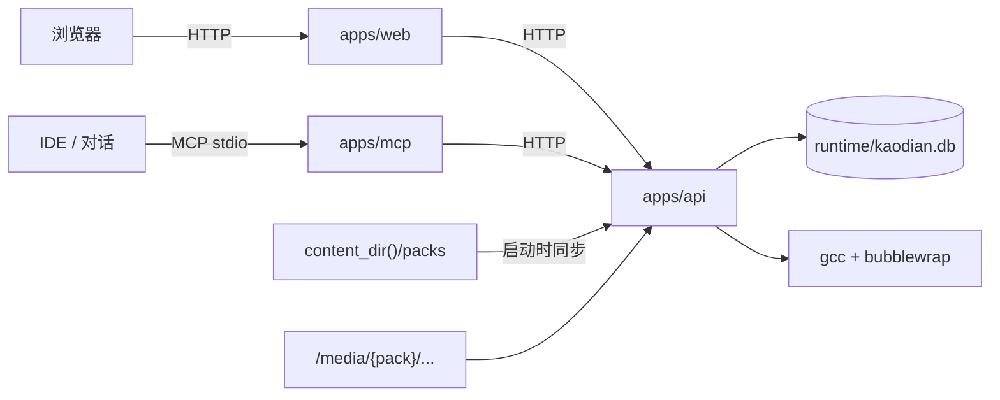

# 架构与目录

## 目录

```
kaodian/                       # 框架仓库（无学科内容）
├── apps/
│   ├── web/                   # 开发源码：前端（React + Vite）
│   │   ├── public/            # UI 素材（favicon、主题脚本）
│   │   └── src/
│   ├── api/                   # 开发源码：后端（FastAPI + SQLite）
│   │   ├── app/
│   │   │   ├── main.py        # 路由（含 /media）
│   │   │   ├── paths.py       # 内容/数据/数据库路径解析
│   │   │   ├── content.py     # pack 读取、校验、同步
│   │   │   ├── schema.sql     # 表结构（v4）
│   │   │   ├── grading.py     # 判分与题目校验
│   │   │   ├── review.py      # 掌握度与复习间隔
│   │   │   └── db.py          # 连接、迁移
│   │   └── tests/
│   ├── cli/                   # `kaodian` 命令行
│   └── mcp/                   # stdio MCP 服务（HTTP 的薄包装）
├── bin/kaodian                # CLI shell wrapper
├── config/                    # 框架默认配置（题型注册表）
├── examples/demo-content/     # 示例内容包（首次启动 / 测试）
├── docs/
├── runtime/                   # 运行时数据（不进 Git，默认）
├── kaodian.example.toml       # 本机路径配置示例
└── AGENTS.md
```

内容仓库是独立目录（默认 `../kaodian-content`，用 `KAODIAN_CONTENT_DIR`
或 `kaodian.toml` 指定），结构见 [`content-packs.md`](content-packs.md)。


## 三个运行进程

| 进程 | 入口 | 作用 |
|---|---|---|
| Web | `apps/web` 构建产物，由 FastAPI 托管 | 浏览器里的学习路径 / 讲义 / 答题 |
| API | `apps/api/app/main.py`（uvicorn） | 数据、判分、计时、组卷、代码沙箱 |
| MCP | `apps/mcp/server.py`（stdio） | 把 API 包成 AI 可调用的工具 |

MCP 不直接连数据库；它只调 API。浏览器也只调 API。**唯一写库路径是 API。**

## 数据流



## 模块职责

| 模块 | 负责 | 不负责 |
|---|---|---|
| `apps/web` | 路由、讲义渲染、答题交互、计时、显示 | 判分、存库、AI 调用 |
| `apps/api` | 数据模型、复习算法、判分、沙箱、统计 | 页面渲染、对话 |
| `apps/mcp` | 工具描述、参数转发、结果裁剪 | 业务规则、直接 SQL |
| `content_dir()` | 内容包：科目 / 大纲 / 讲义 / 题目 / 素材 | 运行状态 |
| `runtime/` | 作答、时长、复习、进度、数据库 | 代码、内容源文件 |

## 数据表

| 表 | 内容 |
|---|---|
| `content_pack` | 已同步的内容包：id / 版本 / schema / 路径 / 时间 |
| `subject` / `outline_node` | 科目（含显示色/图标/排序）与考纲树；带 `pack_id`（subject 还有 `source_key`） |
| `question` | 题目，`status` = pending / approved / rejected；`group_id` 挂材料组；带 `pack_id/source_key` |
| `question_group` | 材料题 / 一拖多：材料正文、媒体、来源 key |
| `question_outline` | 一题多考点；主考点仍是 `question.outline_code` |
| `quiz` / `quiz_item` | 练习单 |
| `attempt` / `answer` | 作答、逐题得分、`grading_status` |
| `review` | 每题的掌握度、下次复习 |
| `page` / `page_progress` | 讲义（`sort_order`/`archived`）、完成状态；`page` 带 `pack_id/source_key` |
| `study_time` | 阅读/练习时长（按天） |
| `agent_session` / `agent_event` | AI 会话与事件流 |

## 版本与内容同步

- `PRAGMA user_version = 4`；旧库启动时先备份为 `*.bak-v{old}-{时间}`，再增量加列/建表。
- 启动时 `init_db` 顺序：迁移 → 执行 `schema.sql`（幂等）→ `content sync`。
- 内容包按自然键 UPSERT：subject `id`、outline `code`、question `id`（无则
  `fingerprint`）、page `subject_id + lesson_key`（大纲页用 `subject_id + kind='outline'`）。
- 同步只更新/插入内容包命中的行，并回填 `pack_id/source_key`；本地运行时创建的
  页面/题目（`pack_id IS NULL`）不动、不删。pack 内删除内容时改 frontmatter
  `status: archived`，不自动删库。
- 新增科目/内容只需改内容仓库；新增题型改 `config/question_types.json`。
- v3 → v4 新增 `content_pack` 表与 `pack_id/source_key` 列、partial unique index；
  v2 → v3 新增 `question_group`、`question_outline` 与题目媒体列。

详见 [`content-packs.md`](content-packs.md)。

## 数据边界

- **源码**：`apps/`、`bin/`，进 Git。
- **框架配置**：`config/`（题型注册表），进 Git；旧学科配置在迁移完成前保留。
- **内容**：独立内容仓库，进它自己的 Git；框架仓库只有 `examples/demo-content`。
- **用户进度**：`data_dir()/kaodian.db`（默认 `runtime/`），不进 Git。
- **学习内容源文件**：内容仓库内的 Markdown / JSON / assets。

## 为什么这样分

1. AI 读代码只看 `apps/` + `docs/dev/`；读内容只看 `docs/content/`；不需要把用户数据读进上下文。
2. 用户数据可以单独备份、迁移、删除，不会误提交。
3. 前端、后端、MCP 各自独立，MCP 可以单独替换或停用。
