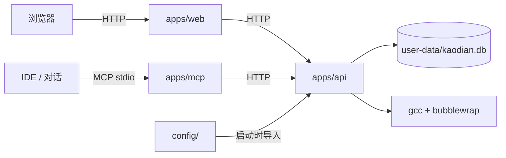

# 架构与目录

## 目录

```
kaodian/
├── apps/
│   ├── web/                 # 开发源码：前端（React + Vite）
│   │   ├── public/images/   # 讲义用的 SVG / 动图
│   │   ├── public/素材库/    # 网上收集的开源素材（含许可证）
│   │   └── src/
│   │       ├── pages/       # Today / Console / Build / Quiz / Result / Review
│   │       ├── components/  # Markdown / Mermaid / MathFigure / CodeTerminal
│   │       └── lib/         # 格式化等小工具
│   ├── api/                 # 开发源码：后端（FastAPI + SQLite）
│   │   ├── app/
│   │   │   ├── main.py      # 路由
│   │   │   ├── schema.sql   # 表结构
│   │   │   ├── grading.py   # 判分与题目校验
│   │   │   ├── review.py    # 掌握度与复习间隔
│   │   │   └── db.py        # 连接、迁移、种子
│   │   └── tests/
│   └── mcp/                 # 开发源码：stdio MCP 服务（HTTP 的薄包装）
├── config/
│   ├── subjects/            # 四科大纲 JSON
│   └── questions/           # 种子题库
├── docs/                    # 文档（本目录）
├── scripts/                 # 大纲导入、MCP 冒烟
├── user-data/               # ★ 用户数据，不进 Git（SQLite）
├── README.md                # 入口
├── AGENTS.md                # AI 工作约定
├── Dockerfile / docker-compose.yml
└── Makefile
```

## 三个运行进程

| 进程 | 入口 | 作用 |
|---|---|---|
| Web | `apps/web` 构建产物，由 FastAPI 托管 | 浏览器里的学习路径 / 讲义 / 答题 |
| API | `apps/api/app/main.py`（uvicorn） | 数据、判分、计时、组卷、代码沙箱 |
| MCP | `apps/mcp/server.py`（stdio） | 把 API 包成 AI 可调用的工具 |

MCP 不直接连数据库；它只调 API。浏览器也只调 API。**唯一写库路径是 API。**

## 数据流



## 模块职责

| 模块 | 负责 | 不负责 |
|---|---|---|
| `apps/web` | 路由、讲义渲染、答题交互、计时、显示 | 判分、存库、AI 调用 |
| `apps/api` | 数据模型、复习算法、判分、沙箱、统计 | 页面渲染、对话 |
| `apps/mcp` | 工具描述、参数转发、结果裁剪 | 业务规则、直接 SQL |
| `config/` | 科目 / 大纲 / 种子题 | 运行状态 |
| `user-data/` | 作答、时长、复习、进度 | 代码、配置 |

## 数据表

| 表 | 内容 |
|---|---|
| `subject` / `outline_node` | 科目与考纲 |
| `question` | 题目，`status` = pending / approved / rejected |
| `quiz` / `quiz_item` | 练习单 |
| `attempt` / `answer` | 作答、逐题得分、`grading_status` |
| `review` | 每题的掌握度、下次复习 |
| `page` / `page_progress` | 讲义、完成状态 |
| `study_time` | 阅读/练习时长（按天） |
| `agent_session` / `agent_event` | AI 会话与事件流 |

## 数据边界

- **源码**：`apps/`，进 Git。
- **课程配置**：`config/`，进 Git。
- **用户进度**：`user-data/kaodian.db`，不进 Git，备份见 `user-data/README.md`。
- **学习内容源文件**：私有学习工作区（不在本仓库）；控制台里的页面是发布后的副本。

## 为什么这样分

1. AI 读代码只看 `apps/` + `docs/dev/`；读内容只看 `docs/content/`；不需要把用户数据读进上下文。
2. 用户数据可以单独备份、迁移、删除，不会误提交。
3. 前端、后端、MCP 各自独立，MCP 可以单独替换或停用。
