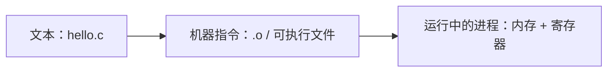
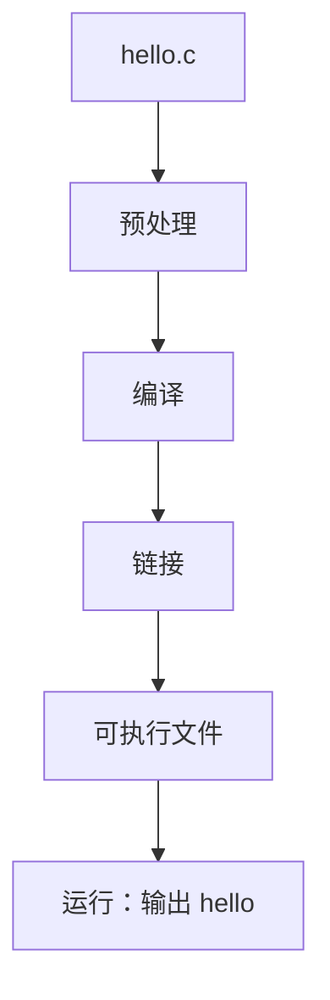
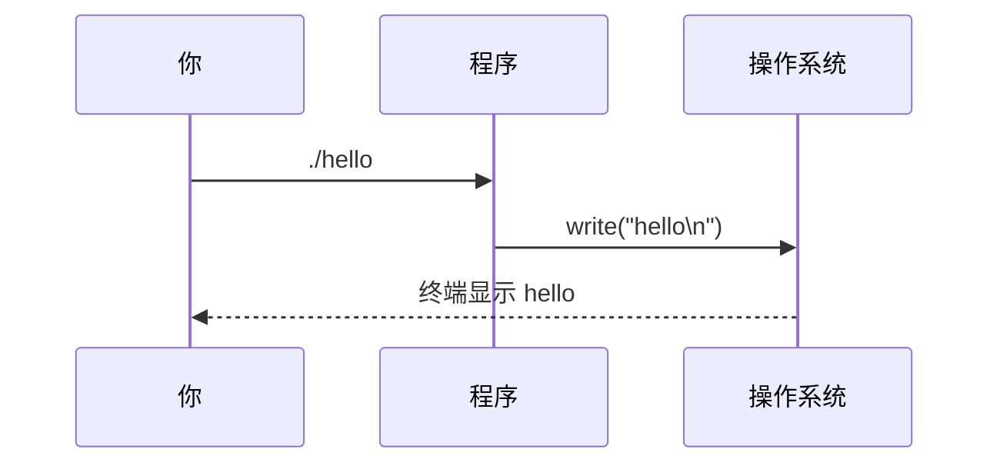

# 第 1 课 · 一行 printf，电脑忙了五步

> 对应 **C-01** ｜ 约 30 分钟
> 今天不背语法。先看清一件事：你敲下的那几行字，是怎么变成屏幕上的 `hello` 的。

## 这节在考试里怎么考

| 内容 | 考纲 | 2021–2024 真题 | 优先级 |
|---|---|---|---|
| `main` 是程序入口 | C-01 | 每年代码都有；2021 判断题直接考 | 必考 |
| `#include` 头文件 | C-01 | 每年出现 2–3 次（代码/选错题） | 必考 |
| 注释 `//` 与 `/* */` | C-01 | 2022、2023、2024 各 1 次 | 常考 |
| 编译/链接五步、gcc 报错原文 | C-01 | 0 次 | 了解 |

> **本课必背**：`main` 的写法与作用、`#include <stdio.h>`、两种注释——这三样每年都在真题里露面。
> **了解即可**：五步编译链接流程、gcc 报错原文（不直接考，但能帮你读懂报错、排除「编译还是链接出错」的选项）。
> **不考**：可视化、图片演示、左侧终端（纯教学辅助，真题不涉及）。

## 先猜三个（30 秒）

别往下翻，先凭直觉选：

1. 删掉 `#include <stdio.h>`，程序还能编译吗？
2. 删掉 `printf("hello\n");` 末尾的分号，会怎样？
3. 删掉 `\n`，屏幕上的输出会变成什么样？

带着这三个问题往下看。答案在文末，但**先猜再对**，你会记得牢得多。

## 一、你写的不是程序，是一张图纸

同一份 `hello.c`，其实有三层身份：

| 身份 | 是什么 | 谁在看 |
|---|---|---|
| 文本 | 你敲的字符 | 编辑器、你 |
| 机器指令 | 0 和 1 | CPU |
| 运行中的进程 | 内存里跑着的东西 | 操作系统 |



你写的是**图纸**，编译器是**翻译**，链接器是**接线员**，操作系统是**舞台**。

这四者之间，隔着五步。任何一步掉链子，程序都到不了你眼前。

## 二、解剖一个最小程序

```c
#include <stdio.h>

int main() {
    printf("hello\n");
    return 0;
}
```

只有 6 行，但每一行都有活干。先看一张解剖图：


一个 C 程序常见的零件有五类：

1. **预处理指令**（`#include`）
2. **函数**（至少一个 `main`）
3. **变量声明**（这个最小程序还没用上，第 2 课出现）
4. **语句**（`printf(...)`、`return 0;`）
5. **注释**（可选的 `//` 或 `/* */`）

> 你可能会问：为什么一定是 `main`？
> 因为操作系统只认这个名字。你把 `main` 写成 `mian`，编译能过，链接会报“找不到入口”。

## 三、从 .c 到 hello：五步接力

```text
hello.c
  ① 预处理   把 #include 的内容贴进来，展开宏
  ② 编译     C → 汇编 → 目标文件 .o
  ③ 链接     把 .o 和 printf 所在的库接起来
  ④ 加载     操作系统把可执行文件放进内存
  ⑤ 运行     从 main 开始，printf 把字节送到终端
```



每一步都可能失败，而且报错长得不一样：

- 少分号 → **编译**报错，位置常常在下一行；
- 函数名拼错 → **链接**报错，说“undefined reference”；
- 数组越界 → 编译、链接都不报，**运行时**才出怪事。

考场上没有编译器，所以这些步骤你要能在脑子里过一遍。

## 四、四个会让你白丢分的地方

这四个错误，真题里反复出现，而且都不难。

**1. `main` 拼成 `mian`**

```c
int mian() {   // 编译能过，链接失败：找不到入口
```

**2. 中文分号**

```c
int a = 3；   // 这个“；”是全角，编译器不认
```

**3. 漏分号，错误却指向下一行**

```c
printf("hello\n")   // 少了 ;
return 0;
```

**4. 注释不是反斜杠**

```c
\ 这是注释      // 错：反斜杠是续行符
// 这才是注释
```

> 还有大小写：`Main`、`Printf` 都不对。C 区分大小写，而且很较真。

## 五、一个反直觉实验：`\n` 不是装饰

把这一行：

```c
printf("hello\n");
```

改成：

```c
printf("hello");
```

很多人以为“只是少了个空行”。实际是：输出 `hello` 之后**不换行**，shell 的提示符会紧跟在后面，变成：

```text
hello$
```

在左边的练习终端里删掉 `\n`，点「运行」，你会亲眼看到提示符挤在同一行。



> 这也是为什么终端里的程序大多以 `\n` 结尾：不是礼貌，是让下一行从行首开始。

## 六、手写任务（10 分钟，不许看 IDE）

用纸笔写一个「个人名片」程序，输出三行：

```text
姓名：张三
目标：2028 公办计算机
今天：第 1 天
```

要求：

1. 只用 `printf`，每行一个 `\n`；
2. 写完后，先在纸上写出你预期的输出；
3. 再在左边的练习终端里跑一遍，对照预测。

**预测和实际不一样的地方，就是你今天真正学到的东西。**

## 七、自测

1. 一个 C 程序必须有的函数是哪个？
2. `#include <stdio.h>` 的作用是什么？
3. 下面哪一行有错？
   - A. `int a = 3;`
   - B. `printf("%d", a);`
   - C. `int b = 4；`
   - D. `return 0;`
4. `printf("A"); printf("B");` 的输出是什么？
5. `return 0;` 的作用是什么？

答案在文末。

## 八、动手看看

- 左边的练习终端：改代码、删分号、删 `\n`，按 Ctrl+Enter 运行
- 🐍 [Python Tutor C](https://pythontutor.com/c.html) —— 把代码粘进去，点 **Visualize Execution**，单步看执行

## 参考答案

手写任务参考：

```c
#include <stdio.h>

int main() {
    printf("姓名：张三\n");
    printf("目标：2028 公办计算机\n");
    printf("今天：第 1 天\n");
    return 0;
}
```

输出：

```text
姓名：张三
目标：2028 公办计算机
今天：第 1 天
```

自测答案：

1. `main`
2. 引入标准输入输出库的声明，让 `printf` / `scanf` 可用
3. C（用了中文分号 `；`）
4. `AB`（没有 `\n`，两次输出在同一行）
5. 告诉操作系统“正常结束”，0 表示成功

开头三个问题的答案：

1. **不能**（或至少会报“隐式声明”）。编译器不知道 `printf` 是什么。
2. **编译错误**，报 `expected ';'`，而且常常指到下一行。
3. **`hello` 后面不换行**，提示符挤在同一行。

## 一句话

**C 程序不是一口气写完的，是五步接力；你只要保证每一棒都不掉。**