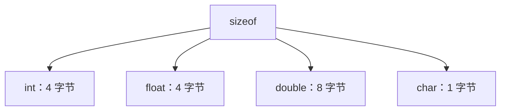
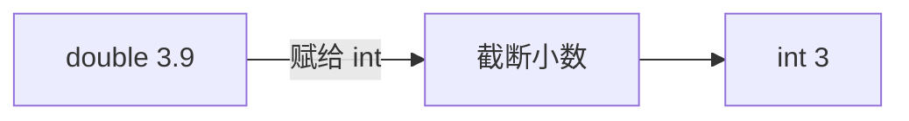

# 第 2 课 · 变量、类型与 sizeof

> 对应 **C-02 / C-03** ｜ 约 35 分钟
> 目标：能正确定义变量、说出四种基本类型的区别与字节数、算对整数截断；`sizeof` 写法了解即可。

## 这节在考试里怎么考

| 内容 | 考纲 | 2021–2024 真题 | 优先级 |
|---|---|---|---|
| 标识符命名规则 | C-02 | 2022 Q4、2023 Q1 | 必考 |
| 四种基本类型与字节数 | C-03 | 2023 填空 31（char 占几字节） | 必考 |
| 整数除法/赋值截断 | C-03 | 2021 Q3、2022 Q7 | 必考 |
| `sizeof` 运算符本身 | C-03 | 0 次（考的是字节数，不是 sizeof） | 了解 |

> **本课必背**：标识符三规则、`int/float/double/char` 的字节数与格式符、`int a = 3.9` 得 3。
> **了解即可**：`sizeof` 运算符的写法与 `%zu`（真题只问「几个字节」，不问 sizeof 语法）。
> **不考**：平台差异、字节数例外（考试统一按 4/4/8/1 记）。

## 一、变量是带名字的盒子

定义一个变量，要告诉编译器三件事：

1. **装什么** —— 类型
2. **叫什么** —— 名字
3. **装多少** —— 初始值（可以暂时不装）

```c
int age;        // 定义：类型 + 名字
age = 20;       // 赋值：往盒子里放 20
int score = 95; // 定义 + 初始化：一步完成
```

## 二、标识符规则

变量名、函数名统称标识符。

**只能用**：字母、数字、下划线 `_`
**不能**：以数字开头、使用关键字、包含空格或符号

| 写法 | 合法？ | 原因 |
|---|---|---|
| `_6_` | ✅ | 字母数字下划线，不以数字开头 |
| `score1` | ✅ | 同上 |
| `6_6` | ❌ | 数字开头 |
| `int` | ❌ | 关键字 |
| `my-age` | ❌ | 减号不是合法字符 |

常见关键字（不能拿来当变量名）：

```text
int float double char void if else switch case
for while do break continue return struct
```

## 三、四种基本类型

| 类型 | 装什么 | 典型大小 | 输出格式符 | 范围（典型） |
|---|---|---|---|---|
| `int` | 整数 | 4 字节 | `%d` | 约 ±21 亿 |
| `float` | 小数（精度低） | 4 字节 | `%f` | 约 6–7 位有效数字 |
| `double` | 小数（精度高） | 8 字节 | `%lf` / `%f` | 约 15–16 位有效数字 |
| `char` | 单个字符 | 1 字节 | `%c` | -128 ~ 127（字符编码） |


> 考试默认按 4 / 4 / 8 / 1 字节记。`sizeof` 的结果和平台有关，但考试不会抠这个例外。

## 四、sizeof

`sizeof` 求一个类型或变量占多少字节：



```c
#include <stdio.h>

int main() {
    int a = 1;
    double b = 2.0;
    char c = 'A';

    printf("%zu\n", sizeof(int));    // 4
    printf("%zu\n", sizeof(double)); // 8
    printf("%zu\n", sizeof(a));      // 4
    printf("%zu\n", sizeof(c));      // 1
    return 0;
}
```

注意：

- `sizeof` 是运算符，不是函数；
- `sizeof(a)` 和 `sizeof a` 都可以；
- 输出用 `%zu`，不要用 `%d`。

## 五、整数截断

```c
int a = 3.9;
printf("%d", a);   // 3
```



浮点数赋给 `int` 时，**直接截断小数部分，不是四舍五入**。

反过来，整数赋给 `double` 会补成小数：

```c
double b = 3;
printf("%.1f", b); // 3.0
```

## 六、字符与字符串不是一回事

```c
char c = 'A';     // 一个字符，单引号
char s[] = "A";   // 字符串，双引号，末尾还有一个 '\0'
```

`'A'` 是字符，占 1 字节；`"A"` 是字符串，占 2 字节（`A` + `\0`）。

## 七、两个必考坑 + 一个补充

1. **`int a = 3.9` 得 3**，不是 4。
2. **`char c = "A"` 是错的**，双引号是字符串。
3. **溢出**（补充：近四年未直接考，知道有这回事即可）：`int` 加到最大值再加 1，会变成负数（未定义/回绕），不要依赖它。

## 八、手写任务（10 分钟）

1. 定义 `int`、`double`、`char` 各一个，分别赋值
2. 用 `sizeof` 输出它们各自占几个字节
3. 计算 `int x = 7 / 2;` 和 `double y = 7 / 2.0;`，输出两个结果，解释差别

## 九、自测

1. 下列哪个是合法标识符？
   - A. `2sum`  B. `sum_2`  C. `double`  D. `sum-2`
2. `sizeof(char)` 等于多少？
3. `int a = 5.8;` 之后 `a` 的值是多少？
4. `char c = "A";` 这行有什么问题？

答案在文末。

## 十、动手看看

- 左边的练习终端：改类型、改值，看 `sizeof` 和输出
- [Python Tutor C](https://pythontutor.com/c.html) —— 单步执行，看变量怎么变

## 参考答案

手写任务参考：

```c
#include <stdio.h>

int main() {
    int a = 10;
    double b = 3.14;
    char c = 'K';

    printf("int: %zu\n", sizeof(a));
    printf("double: %zu\n", sizeof(b));
    printf("char: %zu\n", sizeof(c));

    int x = 7 / 2;
    double y = 7 / 2.0;
    printf("x = %d, y = %.1f\n", x, y);

    return 0;
}
```

输出：

```text
int: 4
double: 8
char: 1
x = 3, y = 3.5
```

自测答案：

1. B
2. 1
3. 5（截断）
4. 双引号是字符串，应改成 `char c = 'A';`

## 一句话

**类型决定盒子装什么、占多大；整数除法会截断，字符用单引号。**