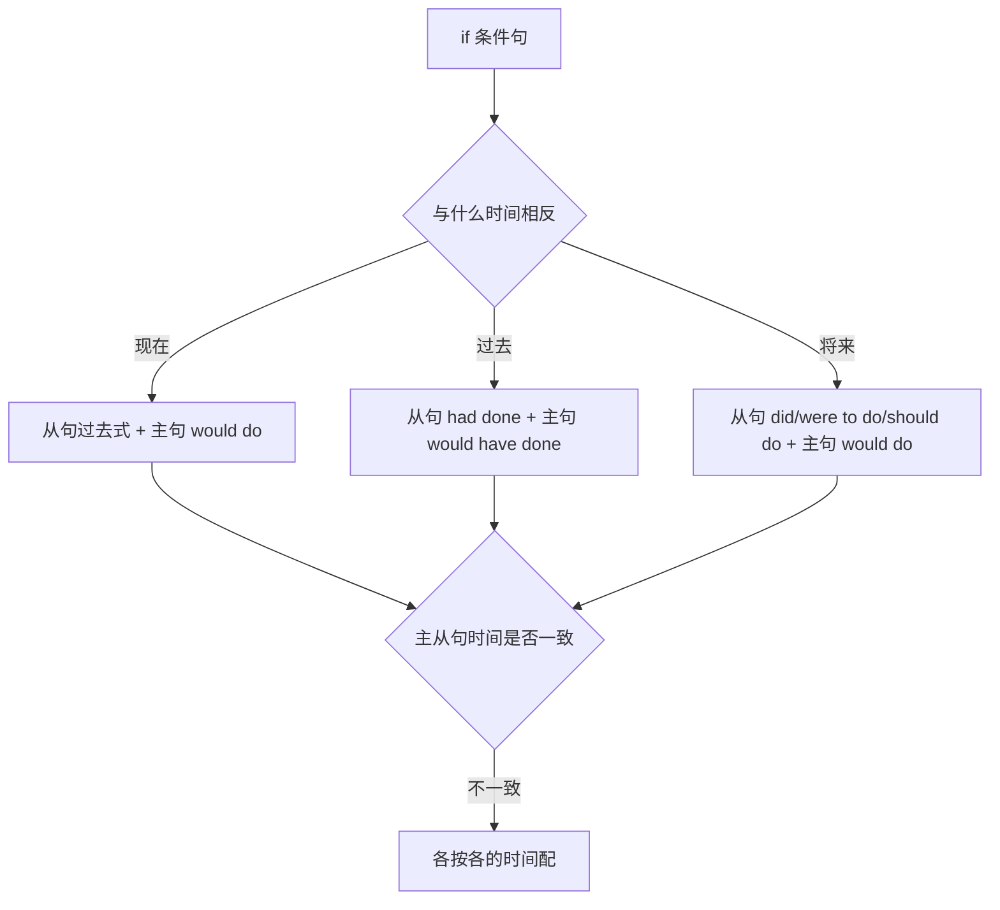

# 虚拟语气 1/1 · if 条件句

> 对应 **E-10** ｜ 约 12 分钟

## 一句话

**虚拟语气说的是“与事实相反”或“不太可能”，时态整体往过去退一步：现在用过去式，过去用过去完成时。**

## 这节在考试里怎么考

**常考。** 单选给你一个与事实相反的语境，让你选 `were / had done / would have done`；语法填空常在 `if` 从句或主句留空；写作里用 `If I were...` 提建议，比 `I think you should` 更有分量。核心就一张三行表，背熟即可。

## 直觉：时态“退一步”表示“不真实”

真实条件：`If it rains, we will stay at home.`（可能下雨，主将从现）
虚拟条件：`If it rained, we would stay at home.`（其实不太可能下）

同样是“如果”，虚拟句把时态往过去推一格，用这种“距离感”告诉对方：**这不是在陈述事实，是在假设。** 所以：

- 与现在相反 → 从句用一般过去时
- 与过去相反 → 从句用过去完成时
- 与将来相反 → 从句用 `were to do` 或 `should do`

## 举三反一

**例 1（最具体：与现在相反）**

`If I were you, I would accept the offer.`
如果我是你，我会接受这个提议。

事实是“我不是你”。从句用过去式，`be` 动词一律用 `were`（口语中 `was` 偶见，考试只认 `were`）；主句用 `would + 动词原形`。

**例 2（一般情形：与过去相反）**

`If he had left earlier, he would have caught the train.`
如果他早点出发，就赶上火车了。

事实是“他没早走，也没赶上”。从句用 `had done`，主句用 `would have done`。两边都必须体现“过去”，只改一边是常见失分点。

**例 3（边界：与将来相反，且省略 if 要倒装）**

`If it should rain tomorrow, the sports meet would be put off.`
万一明天下雨，运动会就推迟。

与将来相反可用 `should do`（万一）、`were to do`（绝不可能）或一般过去时。省略 `if` 时把 `should / were / had` 提到句首：`Should it rain tomorrow, ...`、`Were I you, ...`、`Had he left earlier, ...`。

**反例**：`If I would have known, I would have told you.` ✗ → `If I had known, I would have told you.` ✓。从句里不用 `would have`。

## 一张表：三行背完 if 虚拟

| 时间 | if 从句 | 主句 | 例句 |
|---|---|---|---|
| 与现在相反 | 一般过去时（`be` → `were`） | `would/could/might + do` | `If I knew him, I would ask him.` |
| 与过去相反 | `had + done` | `would/could/might + have done` | `If I had known, I would have called.` |
| 与将来相反 | `did / were to do / should do` | `would/could/might + do` | `If he came tomorrow, I would tell him.` |

| 省略 if 的倒装 | 原句 |
|---|---|
| `Were I you, ...` | `If I were you, ...` |
| `Had I known, ...` | `If I had known, ...` |
| `Should it rain, ...` | `If it should rain, ...` |

## 两个易错点

**1. 从句里用 `would`，或 `be` 用 `was`。** 从句永远不用 `would`：`If I would be rich...` ✗ → `If I were rich...` ✓。与现在相反时 `be` 统一用 `were`：`If he was here` 在考试中判错，写 `If he were here`。

**2. 主从句时间不一致时，仍套同一行。** `If she had taken the medicine, she would feel better now.` 从句说过去（没吃药），主句说现在（现在还不舒服），这叫混合虚拟：**各按各的时间配**。写成 `would have felt better now` 就与 `now` 冲突。

## 自测（3 题）

1. `If I ______ (know) the answer, I would tell you.`
2. `If she had taken the medicine, she ______ (feel) better now.`
3. 判断：`If I was you, I would apologize to him.` 这句语法正确。

## 答案

1. `knew`。与现在事实相反，从句用一般过去时。
2. `would feel`。从句指过去（没吃药），主句有 `now`，指现在，属混合虚拟，主句用 `would + do`。
3. 错误（false）。与现在事实相反的 `be` 动词用 `were`，应改为 `If I were you, I would apologize to him.`

## 一句话

**现在过去式、过去 had done、将来 were to/should do；主句配 would，从句绝不加 would，be 动词只认 were。**
